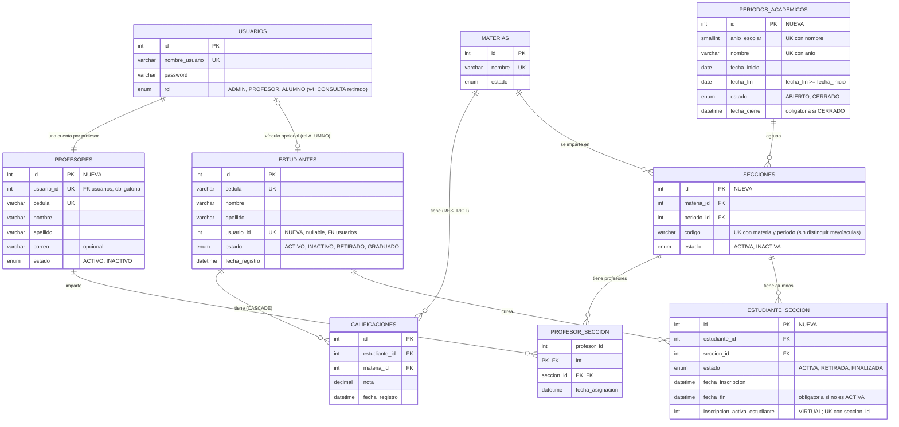

# Diagrama entidad-relación · EduControl · Etapa E (Parte 1)

Tablas existentes (sin cambios de estructura, salvo lo indicado) y tablas nuevas.
Las cardinalidades siguen la notación de Mermaid: `||` uno, `o|` cero o uno, `o{` cero o muchos, `|{` uno o muchos.

## Notas de lectura

- **Una cuenta por profesor.** `profesores.usuario_id` es único y obligatorio. Asignar un profesor a materias o secciones nunca crea una cuenta nueva: solo añade filas en `profesor_seccion`.
- **Alumnos = estudiantes con cuenta.** No existe una tabla `alumnos` separada: se evita duplicar datos. El vínculo `estudiantes.usuario_id` es opcional y único.
- **Sección compartida.** Dos profesores en la misma sección comparten la misma fila de `secciones` y los mismos alumnos en `estudiante_seccion`; no se duplican datos.
- **Historial de inscripciones.** Una alumno puede tener varias filas (RETIRADA, FINALIZADA) para la misma sección. Solo una puede estar ACTIVA a la vez, gracias al índice único sobre la columna virtual `inscripcion_activa_estudiante`.
- **Borrado.** Todas las relaciones académicas usan RESTRICT: no se puede borrar un profesor, una sección o un estudiante con inscripciones o asignaciones. La forma correcta es desactivar. Única excepción existente: `calificaciones` conserva CASCADE al borrar un estudiante (comportamiento actual).
